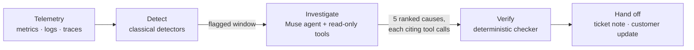

# Epicenter

**Epicenter watches server and service telemetry, detects when it departs from normal, and sends a Meta Muse agent to find which component caused it.** The agent queries metrics, logs, traces and the call graph, and returns five ranked root causes. A deterministic verifier checks the evidence behind every cause, and the agent drafts the internal ticket note and the customer update, citing that evidence sentence by sentence.

It is measured on 468 held-out outages from the [RCAEval](https://github.com/phamquiluan/RCAEval) benchmark against published methods re-run on the same cases, and it can be watched live: break a service in a running microservice shop and see the alarm, the investigation and the verdict as they happen.

Built for the Meta Global AI Developer Hackathon, October 26 – November 4, 2026.

---

## Results at a glance

Top-1 accuracy (AC@1, the true root cause ranked first) on the held-out test split. The investigation starts at the fault time, as RCAEval gives it to every published method.

| Method | RE1 · 225 outages | RE2 · 162 outages | RE3 · 81 outages |
|---|---:|---:|---:|
| N-Sigma, best published baseline | 0.667 | 0.778 | 0.716 |
| No-AI control: rank services by deviation | 0.498 | 0.698 | 0.494 |
| **Muse Spark agent** (hosted, Meta Model API) | **0.951** | **0.963** | **0.975** |
| Muse Spark Open agent (open weights, on Baseten) | 0.893 | 0.969 | 0.988 |
| Muse Glimmer 30B agent, base | 0.653 | 0.586 | 0.580 |
| **Muse Glimmer 30B agent, fine-tuned here** | **0.911** | **0.944** | **0.815** |

- **The Spark agent beats the best published method on every suite** (paired exact McNemar on AC@1: p = 1e-16, 2e-7 and 6e-6).
- **Fine-tuning Meta's 30B open-weight model** on 212 of Spark's verified investigations lifted it from 0.58–0.65 to 0.82–0.94 (p < 0.001 on each suite). Its top-3 accuracy (0.987, 0.988, 0.951) is not significantly different from hosted Spark's on any suite.
- **Live, on a running shop:** the alarm fired on 9 of 9 injected faults, the agent ranked the broken service first on 6 and in its top three on 8.

The agents use every source a case has: metrics, plus logs and traces in RE2 and RE3 (RE1 has metrics only). Every number here comes from a recorded run in [`runs/`](runs) and can be reproduced without network access; see [Reproduce](#reproduce).

---

## How it works



1. **Detect.** Classical detectors (a rolling z-score, an isolation forest and an LSTM autoencoder) flag when the system departs from its recent normal. Detection is deliberately not a language model, so the model's contribution can be measured on its own.
2. **Investigate.** The agent starts from the same top deviations a one-shot prompt would see, then works through up to 10 turns of read-only tools: `compare_to_baseline`, `get_metric_window`, `get_logs`, `get_trace_errors` and `get_dependencies`. A root cause often makes its callers look unhealthy too, so it is asked to tell causes from victims. It finishes with `submit_ranking`: five services, each with an indicator, one sentence of reasoning, a confidence and the IDs of the tool calls that support it.
3. **Verify.** [`src/verify.py`](src/verify.py) accepts a cause only if at least one call it cites was really made and returned evidence for that service at or above the evidence threshold. A cause that fails is rejected and scores as a miss in its rank, so the next guess can't move up into it.
4. **Hand off.** The agent drafts an internal ticket note and a customer update. Every sentence cites evidence, and the share of sentences whose citations check out is reported as groundedness.

The same agent loop runs on three Meta models: Muse Spark through the Meta Model API, Muse Spark Open on Baseten, and Muse Glimmer 30B served by vLLM, before and after fine-tuning. Glimmer speaks Chat Completions rather than the Responses API, so a small adapter ([`src/chat_adapter.py`](src/chat_adapter.py)) translates between the two and leaves the agent, verifier and cache unchanged.

---

## The live lab

[`lab/`](lab) runs Google's [Online Boutique](https://github.com/GoogleCloudPlatform/microservices-demo) (v0.10.5, 11 services) under Docker with an OpenTelemetry collector, next to the investigator. Anyone with the console open can break it:

- **Pick a service and a fault** from a fixed menu: +400 ms network delay, 30% packet loss, CPU starved to 1% of a core, or the service frozen. Nothing is free-form.
- **Watch it unfold.** Outages run one at a time on the shared system: settle, inject, alarm, investigate, diagnose, recover. The console streams the telemetry, the agent's tool calls, the ranked causes and the handoff drafts as they happen.
- **The agent is never told what broke.** The alarm uses the same sustained-deviation rule as the end-to-end evaluation, and the verdict compares the agent's first pick with the injected fault afterwards. Every outage is appended to [`runs/live/incidents.jsonl`](runs/live/incidents.jsonl).
- **Choose who investigates.** Muse Spark Open is the default. When enabled, a visitor can pick the fine-tuned Glimmer instead, served on a dedicated GPU rented on Modal, capped at 5 outages a day.

Every service is measured from its callers' spans as well as its own, the way a service mesh would, so even an untraced service shows up. The calibration batch after that change: alarm on 9 of 9 faults, the broken service ranked first on 6 and in the top three on 8. The three misses are a starved checkout service read as its slow callee, cart-service packet loss read as the Redis it talks to, and a starved frontend, where every request looks slow.

**Alerts in, Slack out.** `POST /webhook/alertmanager` accepts a Prometheus Alertmanager payload and investigates from the alert's start time. A finished investigation can be posted to Slack as a Block Kit message with the causes, the verifier's verdicts and the drafts.

---

## Open weights: fine-tuning Muse Glimmer

Glimmer 30B is Meta's open-weight model, small enough to serve on a single GPU, so a team could keep its telemetry on hardware it controls. Out of the box it often loses the thread of the investigation: on 140 of the 468 test outages it never submitted a ranking within its budget (10 investigation turns, then a final turn offering only `submit_ranking`), or submitted one that didn't parse. When it does answer, its confident answers are mostly right.

So it was taught by the hosted agent ([`scripts/finetune/`](scripts/finetune)):

1. **Lessons.** Hosted Spark investigated every *train-split* case. The 246 runs where it ranked the true cause first *and* the verifier accepted that cause became the lessons (212 to train, 34 to validate). Test cases are never read.
2. **Training.** QLoRA following the recipe in Meta's Muse Glimmer post-training guide, on one H100 on Modal: a 4-bit NF4 base, rank-32 adapters on the language model's projections, 2 epochs. Examples are tokenized with Glimmer's own chat template, and only what the model writes is trained: its reasoning notes, its tool calls in Glimmer's native format and its end-of-turn tokens. Validation loss fell from 0.349 to 0.168.
3. **Evaluation.** One vLLM server holds the base model and the adapter, so both are scored on the same weights, server and settings, on all 468 test outages.

| Glimmer 30B on the test split | Base | Fine-tuned |
|---|---:|---:|
| AC@1 · RE1 / RE2 / RE3 | 0.653 / 0.586 / 0.580 | **0.911 / 0.944 / 0.815** |
| AC@3 · RE1 / RE2 / RE3 | 0.751 / 0.605 / 0.642 | **0.987 / 0.988 / 0.951** |
| Runs that failed to submit a ranking | 140 of 468 | **1 of 468** |
| Median turns per investigation (budget: 10 + 1 final) | 11 | **6** |
| Median seconds per investigation | 126 | **80** |

Against hosted Spark, the tuned model is level on RE2 (0.944 vs 0.963, p = 0.55) and behind on first place for RE1 (0.911 vs 0.951, p = 0.035) and RE3 (0.815 vs 0.975, p < 0.001). Its top-3 accuracy is not significantly different on any suite. The whole fine-tune, from downloading the weights to both test-split evaluations, used about $13 of Modal credit.

---

## Evaluation in detail

**Data.** [RCAEval](https://github.com/phamquiluan/RCAEval) RE1 (375 outages, metrics), RE2 (270, plus logs and traces) and RE3 (90, code-level faults), across three systems: Online Boutique, Sock Shop and Train Ticket. Downloads are MD5-checked. The loader reads an allowlist of telemetry files only; answer material that some cases ship, and the case paths, which contain the answer, never reach a tool or a prompt.

**Split.** [`data_splits.json`](data_splits.json) is a group split by (service, fault) within each system, so near-duplicate instances never cross between train and test: 225 / 162 / 81 test outages. Tools and prompts were developed on train cases only.

**Pre-registration.** The scoring code, configuration, prompt templates and split were tagged [`eval-spec-v1`](https://github.com/MKempler/network-anomaly-detection/tree/eval-spec-v1) before the first model run, and [`eval-spec-v1.1`](https://github.com/MKempler/network-anomaly-detection/tree/eval-spec-v1.1) before the end-to-end runs.

**Scoring.** RCAEval's own rule: a ranked item maps to its service, the first appearance counts, and AC@1, AC@3 and Avg@5 are reported. A failed run, a rejected cause or a missing rank scores as a miss. Intervals are 95%, from a bootstrap over fault groups; comparisons between methods use paired exact McNemar tests on the same cases.

**Baselines.** BARO, N-Sigma and multi-source BARO were re-run with RCAEval 1.8.1 on exactly these cases. The harness reproduces the paper: BARO on the 90 RE2 Train Ticket cases gives AC@1 0.67, AC@3 0.82 and Avg@5 0.80, as in its Table 6.

<details>
<summary><b>Full tables: every method on every suite</b></summary>

AC@1, AC@3 and Avg@5 with 95% intervals; "Failed" counts runs that produced no valid ranking. "One prompt" sees only the top metric deviations, on every suite; the agents use the sources listed.

**RE1** · 225 test outages · metrics

| Method | AC@1 | AC@3 | Avg@5 | Failed |
|---|---|---|---|---:|
| BARO (published) | 0.387 [0.284, 0.498] | 0.640 [0.520, 0.756] | 0.600 | 0 |
| N-Sigma (published) | 0.667 [0.578, 0.751] | 0.884 [0.822, 0.938] | 0.848 | 0 |
| No-AI control | 0.498 [0.400, 0.596] | 0.796 [0.693, 0.889] | 0.747 | 0 |
| Spark, one prompt | 0.844 [0.773, 0.907] | 0.960 [0.929, 0.987] | 0.936 | 0 |
| Spark agent | 0.951 [0.911, 0.987] | 0.996 [0.987, 1.000] | 0.983 | 0 |
| Spark Open, one prompt | 0.822 [0.747, 0.893] | 0.956 [0.920, 0.982] | 0.932 | 0 |
| Spark Open agent | 0.893 [0.836, 0.947] | 0.982 [0.960, 1.000] | 0.964 | 0 |
| Glimmer 30B agent | 0.653 [0.569, 0.738] | 0.751 [0.680, 0.818] | 0.729 | 54 |
| Glimmer 30B agent, fine-tuned | 0.911 [0.862, 0.956] | 0.987 [0.969, 1.000] | 0.971 | 0 |

**RE2** · 162 test outages · metrics, logs, traces

| Method | AC@1 | AC@3 | Avg@5 | Failed |
|---|---|---|---|---:|
| BARO (published) | 0.296 [0.191, 0.420] | 0.877 [0.802, 0.938] | 0.767 | 0 |
| Multi-source BARO (published) | 0.302 [0.198, 0.414] | 0.864 [0.790, 0.932] | 0.765 | 1 |
| N-Sigma (published) | 0.778 [0.691, 0.864] | 0.914 [0.852, 0.963] | 0.889 | 0 |
| No-AI control | 0.698 [0.605, 0.790] | 0.883 [0.815, 0.938] | 0.856 | 0 |
| Spark, one prompt | 0.957 [0.920, 0.988] | 0.975 [0.951, 0.994] | 0.970 | 0 |
| Spark agent, metrics only | 0.901 [0.840, 0.951] | 0.981 [0.957, 1.000] | 0.962 | 0 |
| Spark agent, all sources | 0.963 [0.914, 0.994] | 0.988 [0.969, 1.000] | 0.983 | 0 |
| Spark Open, one prompt | 0.932 [0.877, 0.975] | 0.963 [0.926, 0.994] | 0.959 | 0 |
| Spark Open agent, metrics only | 0.920 [0.858, 0.969] | 0.988 [0.969, 1.000] | 0.973 | 0 |
| Spark Open agent, all sources | 0.969 [0.926, 1.000] | 0.994 [0.981, 1.000] | 0.989 | 0 |
| Glimmer 30B agent | 0.586 [0.512, 0.660] | 0.605 [0.537, 0.673] | 0.604 | 60 |
| Glimmer 30B agent, fine-tuned | 0.944 [0.907, 0.981] | 0.988 [0.969, 1.000] | 0.977 | 0 |

**RE3** · 81 test outages · metrics, logs, traces

| Method | AC@1 | AC@3 | Avg@5 | Failed |
|---|---|---|---|---:|
| BARO (published) | 0.284 [0.123, 0.451] | 0.975 [0.936, 1.000] | 0.822 | 0 |
| N-Sigma (published) | 0.716 [0.575, 0.843] | 0.938 [0.870, 0.988] | 0.889 | 0 |
| No-AI control | 0.494 [0.305, 0.679] | 0.728 [0.544, 0.897] | 0.709 | 0 |
| Spark, one prompt | 0.741 [0.613, 0.863] | 0.938 [0.861, 1.000] | 0.896 | 0 |
| Spark agent, metrics only | 0.938 [0.870, 0.988] | 0.951 [0.885, 1.000] | 0.956 | 1 |
| Spark agent, all sources | 0.975 [0.937, 1.000] | 0.975 [0.937, 1.000] | 0.978 | 0 |
| Spark Open, one prompt | 0.790 [0.667, 0.901] | 0.938 [0.861, 1.000] | 0.911 | 0 |
| Spark Open agent, metrics only | 0.951 [0.905, 0.988] | 1.000 [1.000, 1.000] | 0.988 | 0 |
| Spark Open agent, all sources | 0.988 [0.961, 1.000] | 1.000 [1.000, 1.000] | 0.995 | 0 |
| Glimmer 30B agent | 0.580 [0.481, 0.679] | 0.642 [0.547, 0.738] | 0.627 | 26 |
| Glimmer 30B agent, fine-tuned | 0.815 [0.725, 0.899] | 0.951 [0.904, 0.988] | 0.916 | 1 |

Multi-source BARO is run on RE2 only: it needs RCAEval's log and trace time series (`logts`, `tracets`), which RE3 doesn't ship.

`python scripts/report_explain.py --suite RE2 --part test` prints these tables with every paired McNemar test.

</details>

**What each rung adds.** The ladder runs the same cases through one capability at a time:

- **A language model over the raw ranking:** one prompt over the top metric deviations beats the no-AI control on every suite (p ≤ 2e-6).
- **Investigation over one prompt:** it helps on RE1 (0.844 → 0.951, p = 3e-6) and RE3 (0.741 → 0.975, p = 4e-6). On RE2 a single prompt already scores 0.957; investigating with metrics alone is *worse* (0.901, p = 0.012), and logs and traces bring it back to 0.963 (p = 0.013 against metrics alone). The losses are network faults: with metrics alone the agent gets 0.67 of delay faults and 0.74 of packet-loss faults, and with logs and traces 0.81 and 1.00.
- **Open weights over hosted:** Spark Open matches hosted Spark on RE2 and RE3 and trails it on RE1 with metrics only (0.893 vs 0.951, p = 0.004).

**End to end: our detector chooses where to look.** Here nothing is told the fault time; our detector's flag anchors the investigation, and an outage it never flags is a miss for every method.

| AC@1, detector-anchored | RE1 | RE2 | RE3 |
|---|---:|---:|---:|
| Outages the detector flagged | 202 of 225 | 148 of 162 | 29 of 81 |
| N-Sigma (published), all outages | 0.578 | 0.691 | 0.235 |
| Muse Spark agent (hosted), all outages | 0.831 | 0.864 | 0.346 |
| Muse Spark agent (hosted), flagged outages only | 0.926 | 0.946 | 0.966 |

When the detector fires, the agent is about as accurate as when it is handed the fault time. Detection is the bottleneck, above all on RE3's code-level faults, which often leave little trace in the metrics the detector watches.

**Detection on its own.** On the [SMD](https://github.com/NetManAIOps/OmniAnomaly) dataset (28 servers, 327 labelled anomaly events), each detector is fit per server on the training data alone: the z-score flags beyond 3 standard deviations, and the isolation forest and LSTM autoencoder at the 99th percentile of their training scores. Nothing is tuned on test labels. Scoring is event-level: one labelled segment is one event, and no point adjustment is applied.

| Detector | Precision | Recall | F1 [95% CI] | Mean delay (rows) |
|---|---:|---:|---:|---:|
| Rolling z-score | 0.058 | 0.991 | 0.109 [0.081, 0.143] | 0.3 |
| Isolation forest | 0.091 | 0.651 | 0.160 [0.110, 0.231] | 15.2 |
| LSTM autoencoder | 0.230 | 0.474 | 0.310 [0.255, 0.372] | 9.2 |

**Speed and cost.** On 20 RE1 train outages, an agent investigation took a median of 41 s on hosted Spark (90th percentile 91 s) and 22 s on Spark Open (33 s). Hosted runs use the Meta Model API's Contributor tier, about $0.0055 per investigation ($0.077 at Standard pricing). The Contributor tier allows Meta to train on requests, so only public benchmark data is ever sent through it.

---

## Reproduce

Requires Python 3.13 and, for the live lab, Docker.

```bash
python -m venv venv && source venv/bin/activate
pip install -r requirements.txt
python scripts/download_data.py --rcaeval RE1 RE2 RE3   # SMD and RCAEval from Zenodo, MD5-checked
pytest                                                  # 163 tests: scoring, leakage, tools, lab, API
```

**Every model number, with no network and no API key.** Each model call is recorded in [`runs/llm/`](runs/llm), keyed by a hash of the request, and `--offline` replays a run from that record. The tools recompute their results from the downloaded data, so the verifier re-checks every citation.

```bash
python scripts/run_explain.py --suite RE2 --part test --ranker spark-agent-all --offline
python scripts/run_explain.py --suite RE3 --part test --ranker glimmer-tuned-agent-all --offline
python scripts/report_explain.py --suite RE1 --part test     # tables with intervals and McNemar tests
```

The rankers are `no-ai`, `spark-one-shot`, `spark-agent`, `spark-agent-all`, their `open-*` equivalents, `glimmer-agent-all`, `glimmer-tuned-agent-all`, and the published `baro`, `nsigma` and `mmbaro`. Add `--anchor detector` for the end-to-end runs.

**Detection on SMD:** `python scripts/run_eval.py --detector zscore iforest lstm`

**The console.** It serves the evidence tables and replays of all 468 recorded test investigations. No data download or key is needed.

```bash
uvicorn src.api:app        # then open http://127.0.0.1:8000
```

**The live lab.** It needs `BASETEN_API_KEY` in a git-ignored `.env` at the repo root.

```bash
docker compose -f lab/docker-compose.yml up -d   # Online Boutique, collector and investigator
python scripts/lab_batch.py                      # optional: one fault per service, scored
```

**The fine-tune.** It needs a Modal account.

```bash
python scripts/finetune/build_sft.py                     # lessons from the recorded train-split runs
modal run scripts/finetune/modal_app.py::download        # weights to a Modal volume, once
modal run scripts/finetune/modal_app.py --smoke          # 2 steps on the longest examples
modal run --detach scripts/finetune/modal_app.py         # the full run; checkpoints and resumes
modal deploy scripts/finetune/modal_app.py               # vLLM: base and adapter, behind proxy auth
```

---

## Repository layout

| Path | What it holds |
|---|---|
| [`src/detectors.py`](src/detectors.py), [`src/evaluate_detect.py`](src/evaluate_detect.py) | The detectors and event-level detection scoring |
| [`src/tools.py`](src/tools.py), [`src/agent.py`](src/agent.py), [`src/verify.py`](src/verify.py) | The investigation tools, the agent loop and the evidence checker |
| [`src/explain.py`](src/explain.py), [`src/evaluate_explain.py`](src/evaluate_explain.py) | The no-AI and one-prompt rankers, and RCAEval scoring with statistics |
| [`src/handoff.py`](src/handoff.py), [`src/integrations.py`](src/integrations.py) | Ticket and customer drafts; Alertmanager in, Slack out |
| [`src/llm.py`](src/llm.py), [`src/chat_adapter.py`](src/chat_adapter.py), [`src/cache.py`](src/cache.py) | Model providers, the Chat Completions adapter and the record-and-replay cache |
| [`src/lab/`](src/lab), [`lab/`](lab) | The live lab: telemetry, fault injection, the incident loop and its Compose file |
| [`src/api.py`](src/api.py), [`static/console.html`](static/console.html) | The API and the single-page console |
| [`scripts/`](scripts) | Downloads, evaluations, baselines, reports, replays, the user study and the fine-tune |
| [`runs/`](runs) | Every recorded run: per-case results, model calls, baselines, live incidents |

---

## Limitations

- **Benchmarks are cleaner than production.** RCAEval injects one fault at a time into three demo systems. Real outages overlap, cascade and come with noisier telemetry.
- **Detection is the weak link end to end.** It misses 52 of RE3's 81 outages, and the SMD detectors trade precision against recall at F1 0.11–0.31.
- **The live lab is small.** 11 services, four fault types, and calibration batches of nine outages: a demonstration, not a benchmark.
- **The fine-tuned model still trails the hosted one** on first place for RE1 and RE3. It learned from Spark's actions and short notes; Spark's full reasoning is not available to learn from.
- **In this demo Glimmer runs on a rented cloud GPU.** Keeping telemetry on your own hardware is what open weights make possible, not what this deployment does.

---

## Data and acknowledgements

- **[RCAEval](https://github.com/phamquiluan/RCAEval)** (Pham et al.) provides the root-cause benchmark and the BARO and N-Sigma implementations.
- **[SMD](https://github.com/NetManAIOps/OmniAnomaly)** (Su et al., OmniAnomaly) provides the server telemetry for detection.
- **[Online Boutique](https://github.com/GoogleCloudPlatform/microservices-demo)** (Google) is the live lab's shop.
- **Models:** Muse Spark through the Meta Model API, Muse Spark Open through Baseten, and Muse Glimmer 30B fine-tuned with Meta's post-training recipe and served with Meta's vLLM image on Modal.

Only public data is used anywhere in this repository.

## License

The code is under the [MIT License](LICENSE). The datasets and Online Boutique keep their own licenses.
